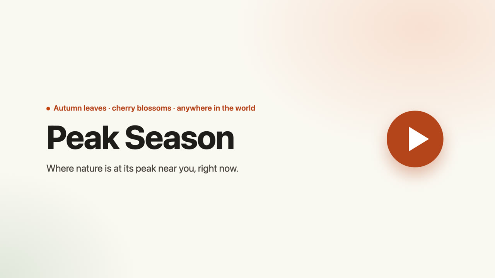

# Peak Season

**Where nature is at its peak near you, right now.** Autumn leaves, cherry blossoms, and more,
anywhere in the world.

Peak Season collects recent public nature photos (iNaturalist) and web reports (SerpApi, for
famous spots). An open-weight model, **Gemma**, runs on a free GitHub Actions runner and judges
how far along each seasonal moment is in each photo. The site then tells you, for wherever you
are, which places nearby are at their best, how fresh the evidence is, and gives you one-tap
directions in your own map app. Decide, tap Directions, go outside.

Built for the DEV Hacktoberfest Open-Source AI Challenge, Week 1: "Touch Grass".

[](https://youtu.be/sB6V2_vK_bE)

- **Live site:** https://peak-season-dvl.pages.dev/
- **Demo video (47 s):** https://youtu.be/sB6V2_vK_bE
- **Runs at $0/month:** a static site plus a scheduled GitHub Actions job. No servers, no
  database, no paid APIs required.

## How it works

```
 every 12 h, GitHub Actions (CPU only, free for public repos)
 iNaturalist (global) ─┐
 SerpApi (famous spots)┼─> normalize ─> Gemma via Ollama ─> aggregate per ~5 km cell ─> JSON shards
                       │                (cached in SQLite)                               │ git commit
                                                                                         ▼
                              Cloudflare Pages: static HTML/JS loads only your region's shard
```

1. **Fetch.** Recent observations of each target's taxa, worldwide, with photos whose license
   allows display (CC0/CC BY variants). Obscured or vague locations are skipped.
2. **Free signals.** iNaturalist phenology annotations ("Colored Leaves", "Flowers") mark a plant
   as in season nearby and move those photos to the front of the queue. They never set a stage,
   because "Colored Leaves" covers everything from turning to past peak.
3. **Classify with Gemma.** Each photo gets strict JSON back:
   `{"is_target_photo", "stage", "progress", "confidence"}`, validated against the plant's stage
   list (retry once, then `unclassified`). Close-ups of bark or a single leaf are rejected. Every
   result is cached by content hash, so a photo is never classified twice.
4. **Budget.** A free CPU can't classify the whole world every run, so each run spends at most
   `MAX_PHOTOS_PER_RUN` photos, 3 per cell, famous spots first, then the busiest cells, within a
   wall-clock deadline. The next run continues where this one stopped.
5. **SerpApi (optional).** For famous spots where the plant is in season nearby but there are
   fewer than 3 reports, search the web in the spot's own language (e.g. `"嵐山" 紅葉 見頃`).
   Gemma reads the snippets in any language. The budget is read from SerpApi's Account API at
   the start of each run, with a reserve, a per-run cap, and a 48 h cache.
6. **Aggregate.** Per (cell, plant): recency-weighted mean of stage scores,
   `w = confidence × kind_weight × exp(−age_days / 3)`. Fewer than 2 reports means
   "Not enough reports"; Peak Season never invents a status.
7. **Export.** Small JSON shards per ~1,250 km region. Visitors only download their region and
   its neighbours, and never trigger an API or model call.
8. **Pages for search engines.** From the same JSON, the job writes plain HTML pages that need no
   JavaScript: a home per language (`/ja/`, `/ko/`, `/zh-tw/`), and a page per famous spot and
   language (`/spots/arashiyama/`, `/ja/spots/arashiyama/`) with its current status, plus
   `sitemap.xml`. It also keeps one status per spot and day in `data/history/<year>.json`, so a
   season's peak dates survive after the shards move on.

## Seasonal targets are config, not code

Everything that differs between maples and cherry blossoms lives in `targets/<id>.yaml` and a
prompt file in `prompts/`. Adding a plant means adding those two files. A plant only appears on
the site after its prompt passes validation against iNaturalist annotations
(`python -m peakseason.validate --target <id>`, ≥70% coarse-stage agreement on ≥20 photos; see
NOTES.md) and `validated: true` is set by hand.

| Target | Stages | Go now |
|---|---|---|
| `maple` (autumn leaves) | Green, Turning, Peak, Past peak | Peak |
| `sakura` (ornamental flowering cherries only, not genus *Prunus*) | Buds, First bloom, Full bloom, Falling petals | First bloom, Full bloom |

## Run it locally

Requirements: [uv](https://docs.astral.sh/uv/) and [Ollama](https://ollama.com).

```sh
uv sync
ollama pull gemma4:e2b-it-qat           # or set MODEL_NAME to another multimodal Gemma
cp .env.example .env                    # optional: SERPAPI_API_KEY etc.

# Small area, small budget (dev):
uv run python -m peakseason.ingest --target maple --bbox "-79.6,43.55,-79.2,43.85" --max-photos 12

uv run python -m http.server -d site 8000
# open http://localhost:8000/?lat=43.65&lng=-79.38&all=1   (all=1 also shows unvalidated plants)
# open http://localhost:8000/?fixtures=1&lat=35.01&lng=135.77  (offline fixture data)
# add &lang=ja (or ko, zh-TW, en) to force a UI language; otherwise the browser's is used

uv run pytest && uv run ruff check . && uv run ruff format --check .
```

## Deploy (all free)

1. **GitHub:** push to a public repo. The `ingest` workflow runs every 12 hours; start one by
   hand from the Actions tab ("Run workflow") or `gh workflow run ingest.yml`. Optional repo
   secret `SERPAPI_API_KEY`; optional repo variables `MODEL_NAME`, `MAX_PHOTOS_PER_RUN`,
   `CLASSIFY_DEADLINE_MIN`. To use a hosted OpenAI-compatible Gemma endpoint instead of the
   runner's CPU, set secrets `MODEL_BASE_URL` and `MODEL_API_KEY`; no code changes.
2. **Cloudflare Pages:** connect the repo, production branch `main`, no build command, output
   directory `site`. Every data commit redeploys the site.

GitHub disables scheduled workflows in public repos after 60 days without repository activity
(it emails a warning first). Re-enable it from the Actions tab.

## Data, licensing and privacy

- Photos are never downloaded into the repo or rehosted. Cards link to the original iNaturalist
  observation and show the photographer's license and attribution. Only photos with a CC0/CC BY
  family license are shown or sent to the model, and images are held in memory only while
  Gemma looks at them.
- Place names are cleaned so that street addresses and postcodes never reach the UI.
- Only official, documented APIs are used (iNaturalist API, SerpApi). No scraping of closed
  platforms.
- The site loads no third-party scripts, fonts or trackers.

**Known limit:** several photos from the same person count as several reports (often one tree
photographed a few times), so one account can make a place show a stage. Gemma still has to
agree with the photos. Counting each observer once is planned.

## Layout

```
peakseason/   ingest (inaturalist, serpapi, budget, runner), model (client, classify),
              geo, targets, aggregate, export, store, config, validate
targets/      maple.yaml, sakura.yaml
prompts/      photo and text prompts (versioned; the version is part of the cache key)
data/         spots.yaml (famous spots, coordinates from OpenStreetMap), history/ (generated)
site/         index.html, app.js, styles.css, about/, 404.html, robots.txt
              generated: data/, spots/, ja/ ko/ zh-tw/, sitemap.xml (python -m peakseason.pages)
tests/        pytest with recorded fixtures from Canada, Japan, Korea and Australia
demo/         the demo video: Playwright clips of the live site, captions and title cards
              rendered from HTML, stitched with ffmpeg (cd demo && npm install && npm run build)
```

## What's next

- More seasonal moments, each just a YAML file plus a prompt: plum blossoms, tulips, lavender,
  sunflowers, tamaracks, ginkgo (yellow), lupins.
- More UI languages. English, Japanese, Korean and Traditional Chinese are in; a language is one
  entry in the `I18N` dictionary in `site/app.js` plus `local_labels` in each target's YAML.
- "Make a day of it": nearby outdoor events for famous spots (Ticketmaster, SerpApi events).
- A "data may be stale" notice if the last run is more than 5 days old.

## Changes after the challenge deadline

The challenge closed on Oct 11, 2026. Commits since then, apart from the scheduled
`data: ingest run` commits:

- **Oct 25:** UX fixes from a usability audit (empty states that point to the closest peak,
  famous spots in the place picker, Directions above the photo, radius labelled in the chosen
  unit, accessibility fixes).
- **Oct 25:** Security hardening (API keys kept out of error messages, `certifi` update, GitHub
  Actions pinned to commit SHAs, Ollama installed from a hash-checked release, tighter CSP).
- **Oct 25:** Demo video and the `demo/` scripts that build it.

## License

Code: MIT. Photos and text belong to their authors and are shown under their own licenses.
